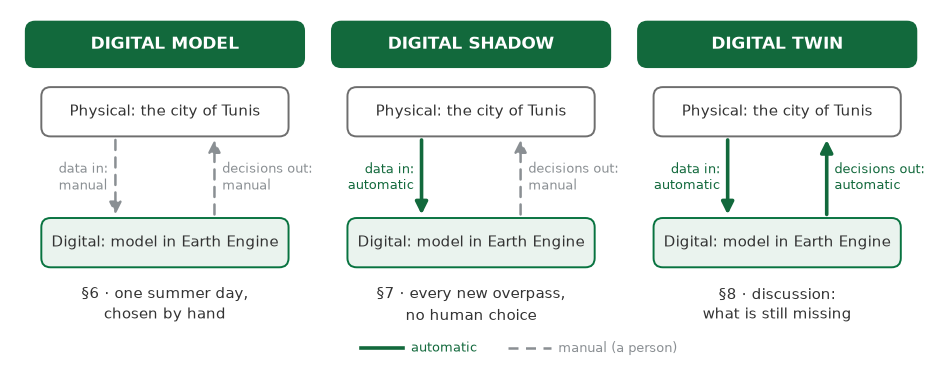
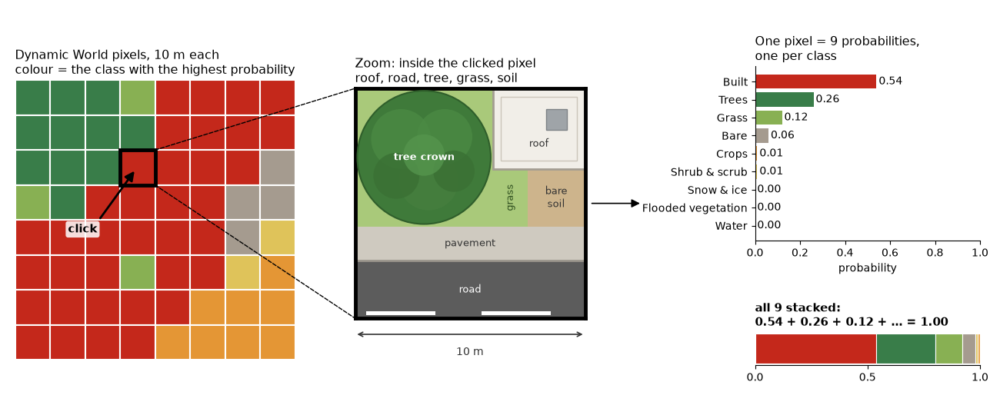
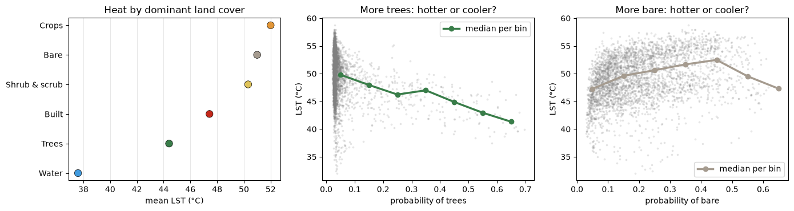
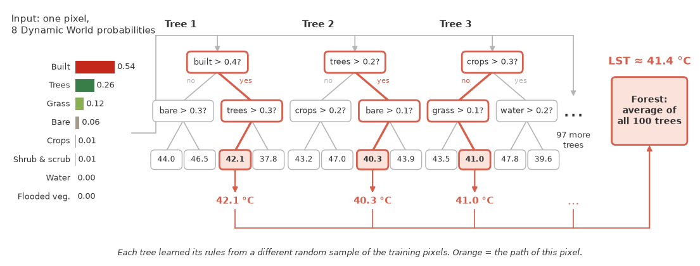
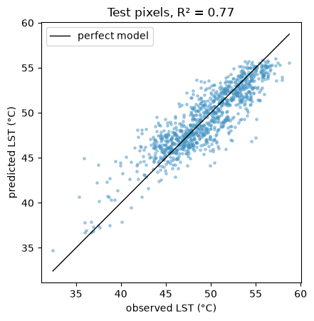
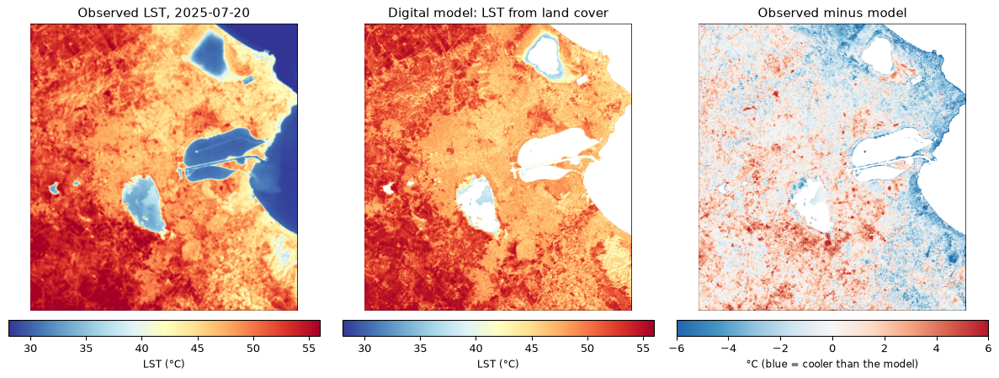
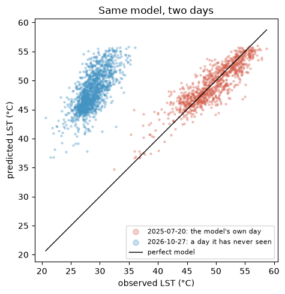
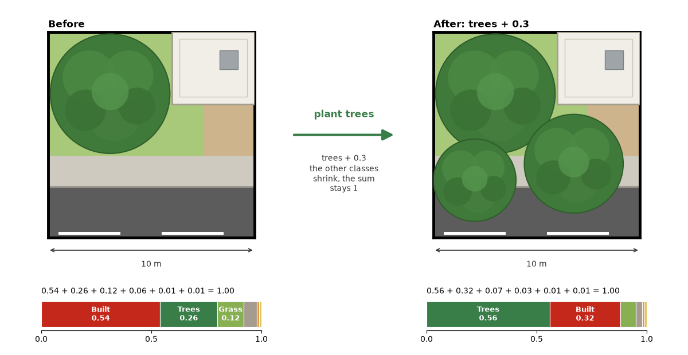
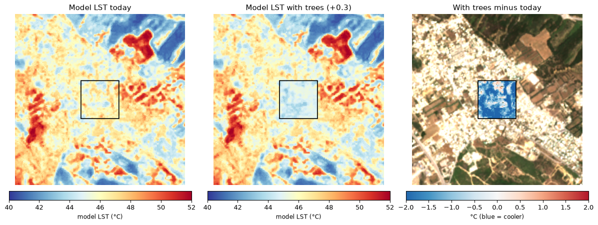

# Satellite thermal imagery as a data feed for an urban heat island digital twin

**DTT4SD workshop · Tunis, 10 November 2026 · Session 4, hands-on**

**Author:** Bruno Ćaleta, Oikon Ltd.

---

You build the first levels of a digital twin of the Tunis urban heat island.
You use real satellite data and Google Earth Engine.
Everything runs in your browser, in Google Colab.

Three levels of integration (Kritzinger et al. 2018).

### Notebooks

Tutorial: 

[Tutorial with outputs](DTT4SD_Tunis_UHI_hands_on_with_outputs.ipynb) (to read on GitHub, for example if your Earth Engine project does not work). Its maps are static snapshots.

### You need

- A Google account.
- A Google Cloud project registered for noncommercial Earth Engine use. It is free. Section 1 of the notebook shows how, in about 5 minutes.
- Nothing to install. Colab already has `earthengine-api` and `geemap`.

### How to run

1. Click **Open in Colab** above.
2. Save your own copy: **File → Save a copy in Drive**. Work in that copy.
3. Type your project ID in cell 1.1.
4. Run the cells in order with **Shift + Enter**.

### Outline

| § | What you do | Minutes |
|---|---|---|
| 1–2 | Connect to Earth Engine and define the study area | 10 |
| 3 | Find the clear summer days and look at one Landsat scene | 5 |
| 4 | Turn the thermal band into land surface temperature | 6 |
| 5 | Describe the land cover with Dynamic World | 5 |
| 6 | Stage 1 · Digital model: train and test a Random Forest | 9 |
| 7 | Stage 2 · Digital shadow: a live feed of the newest overpass | 8 |
| 8 | Stage 3 · Digital twin: simulate planting trees, close the loop | 10 |
| 9 | Use it for your own area | after the workshop |

### What you will build

**Calculate surface temperature from satellite imagery (§3–4).**
Landsat 8 and 9 pass over Tunis at about 11:00 local time.
Their thermal band gives land surface temperature (LST) at about 100 m.
You pick one clear summer day, 20 July 2025, and turn the band into °C.

**Land cover model (§5).**
Dynamic World gives every 10 m pixel nine probabilities, one per land-cover class.
They add up to 1.
You average them over summer 2025 and compare them with the heat.

**Stage 1 · Digital model (§6).**
A Random Forest learns LST from the eight land-cover probabilities.
You train it on 70 % of the land pixels and test it on the other 30 %.

  
  

**Stage 2 · Digital shadow (§7).**
The data keep coming.
One function takes the newest clear satellite overpass, refreshes the land cover and applies the model again.

**Stage 3 · Digital twin (§8).**
A twin lets you ask "what if?".
You plant trees in 16 ha of dense housing between Gammarth and La Marsa.

The model expects the area to cool by about 1 °C.
The notebook ends with how to close the loop: plant, let the shadow observe, retrain.

### Data

- [Landsat 8 and 9, Collection 2, Level 2](https://developers.google.com/earth-engine/datasets/catalog/LANDSAT_LC09_C02_T1_L2) (USGS), land surface temperature at about 100 m.
- [Dynamic World V1](https://developers.google.com/earth-engine/datasets/catalog/GOOGLE_DYNAMICWORLD_V1) (Google, World Resources Institute), land cover probabilities at 10 m.

All data come from the Earth Engine catalogue. Nothing is downloaded to your computer.

### Reuse

You may reuse this material in other courses.
Please credit the DTT4SD workshop in Tunis and the author, and keep a link to this repository.

The code is under the [MIT License](LICENSE).
The text and figures are under [CC BY 4.0](https://creativecommons.org/licenses/by/4.0/).

### Contact

Bruno Ćaleta, Oikon Ltd. – [bcaleta@oikon.hr](mailto:bcaleta@oikon.hr)

---

Prepared by OIKON for the DTT4SD Erasmus+ project.
